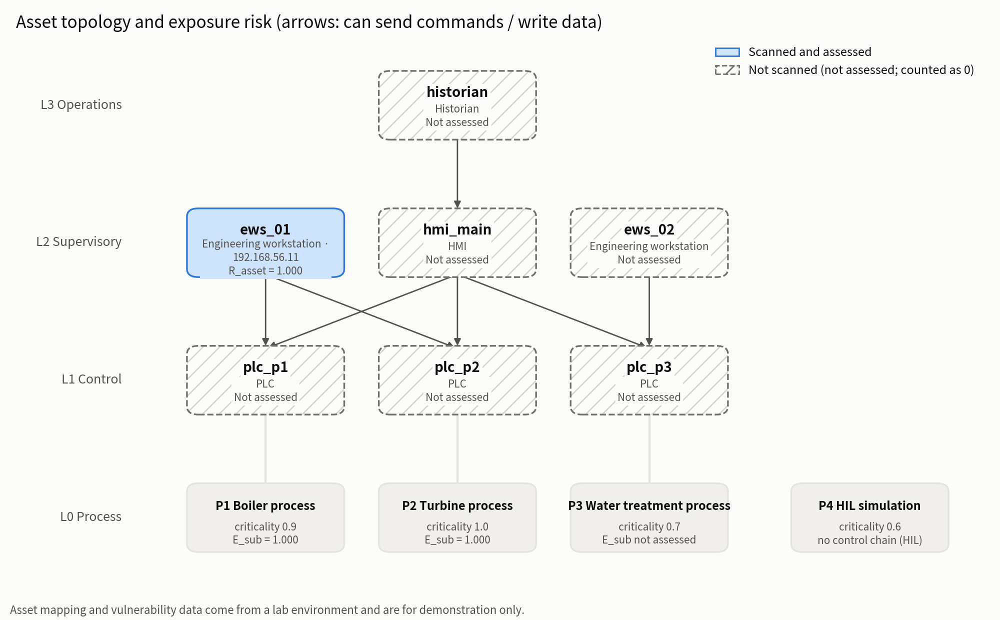
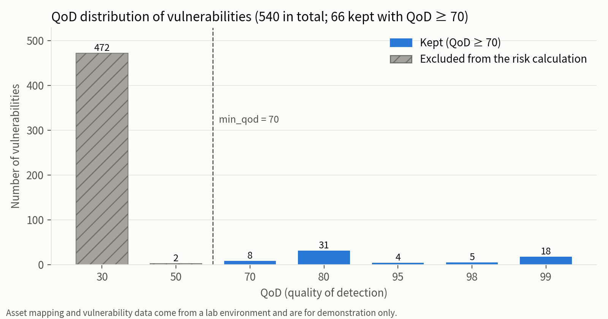

# 面向工控系统的"过程异常检测 + 漏洞上下文"融合告警原型

[English](README.md) | **中文**

**状态：代码和实验已完成；书面报告撰写中。**

> 资产映射与漏洞数据来自实验环境，仅用于演示。资产映射是人为构造的，漏洞数据来自自建靶机扫描，
> 与 HAI 中的攻击没有因果关系；融合部分不声称提升检测指标，只作为原型演示与案例研究。

- **主线**：在 HAI 21.03 上只用正常数据训练 LSTM 自编码器，做无监督攻击检测，与 4 个对比模型比较，并按传感器重构误差做归因。
- **扩展**：把报警的 Top-k 传感器映射到虚构的工控资产，结合 OpenVAS 对实验靶机的真实扫描、
  CISA KEV 与 FIRST EPSS 情报，计算告警优先级并生成告警卡片。

报警输入默认是真实报警 `data/processed/alerts.json`：LSTM-AE 在集群上完整运行后，在 HAI 21.03 测试集上的全部 1,703 条报警段
（`"is_mock": false`，是模型的原始输出，其中包含误报）。融合打分对全部报警进行，卡片和演示页面只显示优先级最高的前 50 条
（`config.yaml` 的 `fusion.max_rendered_alerts`）。mock 报警 `data/mock/alerts.json`（每条带 `"is_mock": true`）仍然保留：
流水线加 `--mock`、演示页面在侧边栏切换，由它派生的输出都标注 [MOCK]。

界面和报告素材默认用英文显示（`config/config.yaml` 的 `ui.lang: en`；改成 `zh` 或设置环境变量 `UI_LANG=zh` 即为中文）。
显示语言只影响文字：Streamlit、告警卡片、索引页、案例文档和图表的标题、坐标轴、图例；不影响任何计算、字段名和数字。

## 环境

```bash
python3 -m venv .venv
.venv/bin/pip install -r requirements.txt
.venv/bin/python -m pytest -q          # 全部测试，不联网
```

OpenVAS 使用 Greenbone Community Containers（Docker Compose），gvmd socket 路径见 `config/config.yaml` 的
`gvm.socket_path`。扫描只针对 host-only 实验网 `gvm.lab_subnet` 内的靶机，需要 GVM 凭据的操作（扫描）由使用者手动运行。

## 主线：结果摘要

全部数字来自学校集群（Minerva，NVIDIA L4）上的完整运行；本地只做开发和冒烟测试。带口径和来源的完整清单见
[`reports/main/key_numbers.zh.md`](reports/main/key_numbers.zh.md)，文件索引见 [`reports/main/README.zh.md`](reports/main/README.zh.md)。

**检测**（HAI 21.03 test1~5，50 个攻击事件；阈值 = val_thr 分数的 99% 分位数；**不使用 point-adjust**，所以逐点 F1 偏低是预期结果）

| 模型 | precision | recall | F1 | AUROC | 事件检出 | 误报（次/小时） |
|---|---|---|---|---|---|---|
| pca | 0.095 | 0.841 | 0.170 | 0.901 | 48/50 | 7.2 |
| iforest | 0.414 | 0.483 | 0.446 | 0.835 | 35/50 | 6.8 |
| **lstm_ae（主模型，5 个种子）** | 0.293 | 0.803 | **0.429 ± 0.018** | **0.934 ± 0.002** | 49.6/50 | 13.2 ± 1.7 |
| lstm_vae | 0.061 | 0.811 | 0.113 | 0.880 | 48/50 | 21.2 |
| deep_svdd | 0.168 | 0.829 | 0.280 | 0.906 | 49/50 | 69.3 |

- LSTM-AE 一行是 5 个随机种子的均值（F1、AUROC、误报率带样本标准差）；其余模型只有单个种子。
- LSTM-AE 的 AUROC 和事件检出最高；它的误报段数高于 PCA 和 IsolationForest。
- 对事先固定的主配置（W=60、hidden=64），LSTM-AE 的逐点 F1 与 IsolationForest 的差距在随机波动范围内，无法区分哪个更好。
  这个结论只针对主配置：消融中其他 LSTM-AE 配置的 F1 差别很大（见下），每个配置只有单个种子，也没有据此选模型。
- LSTM-VAE 和 Deep SVDD 明显不如 LSTM-AE。所有模型在 test 上的报警比例都高于验证集上的 1%（阈值迁移不好，推测是正常工况漂移）。
- 消融（W × hidden，9 个组合）：结果对配置很敏感且不单调，F1 在 0.08~0.62 之间；事先固定的主模型配置（W=60、hidden=64）按 F1 排第 5，没有据此修改。
- 消融中 AUROC 稳定（0.899–0.946），而 F1（0.084–0.617）和误报率（0.33–74.66 次/小时）变化极大：这说明基于阈值的指标主要受阈值迁移和分布漂移影响，
  而不是模型区分攻击与正常数据的能力。需要注意：消融的每个配置只有单个种子；这一解读是事后分析，不是经过检验的假设。

**归因**（Top-1 传感器所属子系统是否在事件的子系统集合内；方括号为 95% Wilson 置信区间）

| 模型 | 报警段命中率 | 按事件命中率（事件的第一个报警段） |
|---|---|---|
| lstm_ae | 54/72 = 0.750 [0.639, 0.836] | 43/50 = 0.860 [0.738, 0.930] |
| lstm_vae | 52/57 = 0.912 [0.811, 0.962] | 47/48 = 0.979 [0.891, 0.996] |
| pca | 37/53 = 0.698 [0.565, 0.805] | 36/48 = 0.750 [0.612, 0.851] |

- 50 个事件里 34 个涉及 P1，不看数据总是回答 P1 就有约 0.68 的命中率：PCA 与这条参照线基本相同，LSTM-AE 略高，LSTM-VAE 明显更高。
- LSTM-AE 的未命中集中在短报警段：超过 60 秒的报警段命中 46/48，不到 10 秒的只有 7/20。
- 传感器级 Hit@k 没有做（数据中没有逐传感器的攻击目标）。

**融合排序**：1,703 条真实报警中 72 条与攻击重叠；按原始分数、α=0、α=1 三种方式排序，precision@10 / @20 / @50 都是 10/10、20/20、45/50，
没有可测量的差别。排序的作用来自异常分数，不来自漏洞上下文。三个案例见 [`reports/main/cases.md`](reports/main/cases.md)。

### 主线：复现

```bash
# 本地：单元测试与冒烟（1% 数据、1 个 epoch；冒烟的数字不进报告）
.venv/bin/python -m pytest -q
bash cluster/train_one.sbatch --smoke lstm_ae

# 集群：完整训练、打分、阈值、评估（命令与顺序见 docs/cluster_queue.md，操作步骤见 docs/cluster_runbook.md）
sbatch cluster/baselines.sbatch
sbatch cluster/train_one.sbatch lstm_ae          # lstm_vae、deep_svdd 同理
sbatch cluster/ablation_array.sbatch

# 本地：同步产物后生成全部表图（顺序见 docs/cluster_queue.md 末尾）
scripts/pull_artifacts.sh
.venv/bin/python -m scripts.make_main_report && .venv/bin/python -m scripts.make_figures
.venv/bin/python -m scripts.make_ablation_report && .venv/bin/python -m src.attribution
.venv/bin/python -m scripts.export_alerts && .venv/bin/python -m src.eval.fusion_ranking
.venv/bin/python -m src.pipeline --offline && .venv/bin/python -m scripts.make_cases
.venv/bin/python -m scripts.make_key_numbers
```

主线的硬性约束：只用 train1~3 训练；test 只在最终评估时读取，不用于调参、选阈值、选模型或早停；scaler 只在训练部分 fit；
滑窗不跨越文件边界和切分点；标签只在 `src/eval/labels.py`、`src/evaluate.py`、`src/attribution.py` 中读取（有自动测试检查）。
官方发布的 train1 末尾 43,201 秒与 test3 开头是同一份数据，已从训练集删除；不删除可能低估 test3 上的误报（未实测）
（见 `reports/main/data_summary.md`，英文说明见 `reports/main/data_overlap.md`）。
各文档中引用的"约束 N""决策 N"的编号和内容见 [`docs/design_decisions.md`](docs/design_decisions.md)（英文）。

## 扩展部分：快速开始

```bash
# 一键流水线：parse → intel → prioritize → render（--offline 只用 data/intel/ 缓存；--mock 改用 mock 报警）
.venv/bin/python -m src.pipeline --offline

# 报告素材：拓扑图、QoD 分布、KEV 表、关键数字 → reports/extension/
.venv/bin/python -m scripts.make_extension_report

# 交互演示：告警列表、卡片、资产风险，侧边栏调参实时重算；默认读真实报警，侧边栏可切换到 mock
.venv/bin/streamlit run app/streamlit_app.py

# 案例：按固定规则从真实报警中挑 3 条 → reports/main/cases.md（需要先跑流水线和 python -m src.attribution）
.venv/bin/python -m scripts.make_cases
```

告警卡片输出到 `reports/cards/`（`index.html` 为按优先级排序的索引页；mock 的在 `reports/cards_mock/`）。
融合排序的评估（precision@k）见 `reports/main/fusion_ranking_eval.md`，三个案例见 `reports/main/cases.md`。

## 扩展部分：流程与模块

```
OpenVAS XML ──parse_report──▶ vulns.json ──intel(KEV/EPSS)──▶ vulns_enriched.json ─┐
alerts.json（主线 / mock）─────────────────────────────────────────────────────────┤
asset_map.yaml ──asset_graph──▶ 传感器→子系统→上游资产/入侵路径 ────────────────────┤
                                                                   risk + prioritize ▼
                                                    enriched_alerts.json ──render_card──▶ 卡片 + 索引页
```

| 步骤 | 模块 | 说明 |
|---|---|---|
| 扫描 | `scripts/smoke_scan.py` | 预检 / `--execute` 扫描 / `--report-id` 导出；报告过滤串 `levels=chmlg`（必须含 c，否则 Critical 被静默丢弃） |
| 解析 | `src/vuln/parse_report.py` | 多份报告合并；三数核对（导出条数 = filtered = full）；丢弃 Log；按 (IP, 端口, NVT) 去重；不按 QoD 过滤 |
| 情报 | `src/vuln/intel.py` | KEV 官方 JSON（缓存 24 小时）；EPSS API 分批（≤100 个、cve 参数 ≤2000 字符），按 CVE 缓存；`--offline` |
| 资产图 | `src/fusion/asset_graph.py` | pydantic 校验 `asset_map.yaml`；上游资产 = 子系统资产 ∪ 反向可达；入侵路径 = 无入边资产 → PLC 的极大简单路径 |
| 风险 | `src/fusion/risk.py` | r_v、R_asset、E_sub；QoD < min_qod 不参与，命中 KEV 的列入"需人工核实"；未扫描资产为"未评估"（计算中按 0） |
| 排序 | `src/fusion/prioritize.py` | S、跨子系统加权、priority、排名，输出带免责声明 |
| 卡片 | `src/fusion/render_card.py` | Jinja2 生成 Markdown / HTML 卡片与索引页 |
| 流水线 | `src/pipeline.py` | 以上步骤一条命令执行；内容未变时不改写快照；只为优先级前 N 条生成卡片 |
| 演示 | `app/streamlit_app.py` | 可选的交互界面，默认读真实报警、可切换到 mock；调参只影响页面，不写文件 |

## 融合打分

参数在 `config/fusion.yaml`（默认 α = 1、β = 1、γ = 1.5、min_qod = 70）：

1. 单条漏洞风险 `r_v = min(1, cvss/10 × (1 + β·epss) × (γ if in_kev else 1))`
2. 资产风险 `R_asset = max(r_v)`；已扫描无漏洞记 0，未扫描记"未评估"（计算中按 0）
3. 子系统暴露风险 `E_sub = max(R_asset)`，遍历子系统全部上游资产
4. 异常严重度 `S = clip(max_score / threshold − 1, 0, 1)`
5. 告警优先级 `priority = S × Σ_sub w_sub·(1 + α·E_sub)·criticality_sub`，w_sub 为 Top-k 误差占比在可识别传感器上的归一化值

资产映射（`config/asset_map.yaml`）：子系统与 HAI 21.03 的列前缀一致（P1 锅炉、P2 汽轮机、P3 水处理、P4 HIL 仿真）。
P4 没有独立控制链（assets 为空），卡片提示同时排查 P1/P2/P3（P4 与三者都有物理耦合）。PLC 按 OT 实践不主动扫描。

## 扩展部分：结果摘要（真实扫描数据）

详见 `reports/extension/key_numbers.md` 与 `kev_table.md`。

- 靶机 ews_01（Metasploitable2）：630 条结果 → 540 条漏洞（Critical 101 条），涉及 1086 个 CVE。
- 命中 KEV 9 条；其中 7 条 QoD 仅 30（版本横幅比对），列为"需人工核实"。
- min_qod = 70 后保留 66 / 540 条（丢弃 88%）。
- R_asset(ews_01) = 1.000；E_sub：P1 = P2 = 1.000，P3 未评估，P4 无控制链。





## 局限性

- **单靶机、风险饱和**：只有 ews_01 被扫描评估；18 条漏洞的 r_v 截断到 1.0，E_sub 只能取 0 或 1，
  无法区分 P1 与 P2 的暴露程度。其余上游资产未评估，卡片中提示"实际风险可能被低估"。
  第二台靶机（hmi_main）的搭建说明与前后对比脚本已备好（`docs/e3_hmi_main_setup.md`、`scripts/compare_fusion.py`），作为未来工作。
- **QoD 与误报**：88% 的结果 QoD 为 30（远程版本比对），Metasploitable2 上多为真阳性，但一般环境中可能因发行版回移补丁产生误报。
- **主线：阈值迁移与误报**：验证集 99% 分位的阈值在测试集上产生的报警远多于 1%，LSTM-AE 平均每小时约 13 个误报段；
  1,703 条报警中只有 72 条与攻击重叠。没有在测试集上调阈值或改评估方法。
- **主线：单一数据集、多数结果为单个随机种子**：只在 HAI 21.03 上评估；只有 LSTM-AE 主配置跑了 5 个种子。
  主模型配置事先固定，在消融中不是最好的组合。训练到 50 个 epoch 时损失仍在缓慢下降。
- **主线：归因评估粗**：只能评估到子系统一级，分母小、置信区间宽；P4 没有子系统标签；没有传感器级的 Hit@k。
- **融合打分**：异常严重度 S 在分数达到阈值 2 倍时就封顶，高分的真实攻击与刚过 2 倍阈值的误报得到相同的 S（见 `reports/main/cases.md`）；
  融合排序相对按原始分数排序没有可测量的差别。改进打分公式留作未来工作。
- **因果关系**：资产映射为人为构造，漏洞与 HAI 攻击无因果关系；融合结果不能作为检测指标，只用于演示告警富化与排序。
- **情报时效**：KEV/EPSS 为 2026-09-29 的快照（`data/processed/vulns_enriched.json`），复现报告数字请使用 `--offline`。

## 目录

```
config/           config.yaml（路径与参数）、asset_map.yaml、fusion.yaml
data/samples/     OpenVAS 报告样本、HAI 21.03 列名
data/processed/   vulns.json、vulns_enriched.json（真实数据快照，入库）
data/mock/        mock 报警（入库）
data/intel/       KEV / EPSS 缓存（不入库）
data/processed/alerts.json  真实报警（LSTM-AE，入库）
src/data/         HAI 读取、预处理、滑窗（不读标签）
src/models/       LSTM-AE、LSTM-VAE、Deep SVDD、PCA、IsolationForest
src/eval/         labels（唯一读标签处）、segments、metrics、alarms、fusion_ranking
src/run_model.py  主线运行入口（prepare → train → diagnose → score → threshold → evaluate）
src/attribution.py  归因与命中率评估
cluster/          集群作业脚本（由 config/cluster.yaml 生成）
reports/main/     主线报告素材（集群完整运行的结果，入库）；索引见 reports/main/README.zh.md
src/vuln/         parse_report、intel
src/fusion/       asset_graph、risk、prioritize、render_card
src/pipeline.py   一键流水线
templates/        卡片与索引页模板
app/              Streamlit 演示
scripts/          扫描、检查、mock 生成、报告素材、前后对比
reports/extension/  报告素材（真实数据，入库）；reports/cards/、reports/cards_mock/ 可由流水线重新生成，不入库
docs/             集群说明与操作步骤（cluster_notes、cluster_runbook、cluster_queue）；hmi_main 搭建说明（未来工作）
```

## 说明

- **提交号**：`run_manifest.json` 和 `PROGRESS.md` 中的提交号来自私有开发仓库，在本公开仓库的历史中不存在。
- **AI 辅助开发**：本项目在 AI 辅助下开发（Claude Code），`docs/cluster_queue.md` 和 `docs/cluster_runbook.md` 中提到了这一工作方式。
  研究设计、评估方法和结论均出自本人。

## 引用

本项目使用 HAI 21.03 数据集。[HAI 官方仓库](https://github.com/icsdataset/hai)要求使用 HAI 21.03 的工作引用以下文献
（BibTeX 取自其 README，省略了 abstract 字段）：

```bibtex
@inproceedings{10.1145/3474718.3474719,
    author = {Shin,  Hyeok-Ki and Lee, Woomyo and Yun, Jeong-Han and Min, Byung-Gi},
    title = {Two ICS Security Datasets and Anomaly Detection Contest on the HIL-Based Augmented ICS Testbed},
    year = {2021},
    isbn = {9781450390651},
    publisher = {Association for Computing Machinery},
    address = {New York, NY, USA},
    url = {https://doi.org/10.1145/3474718.3474719},
    doi = {10.1145/3474718.3474719},
    booktitle = {Cyber Security Experimentation and Test Workshop},
    pages = {36–40},
    numpages = {5},
    keywords = {security dataset, testbed, artificial intelligence, hardware-in-the-loop, industrial control system, anomaly detection},
    location = {Virtual, CA, USA},
    series = {CSET '21}
}
```
